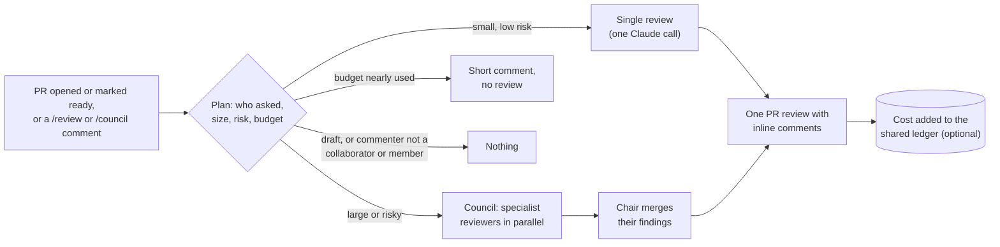

# review-bot

[](https://github.com/JackScammell/review-bot/actions/workflows/ci.yml)
[](LICENSE)
[](https://www.python.org/)
[](https://docs.claude.com/)

**Automatic Claude code reviews on your GitHub pull requests, across as many repos as you like, paced against one monthly budget you set.**

Small PRs get a single focused review. Large or risky ones get a *council*: several specialist reviewers (security, code quality, testing, performance and others, chosen by what the PR touches) review in parallel, and a chair merges their findings into one review. With the optional spend ledger, the bot steps down from councils to single reviews to none as the month's budget fills. The hard cap is the spend limit on your Anthropic Console workspace.

---

## What a review looks like

> *Illustrative example: a council someone asked for with `/council` on a mid-sized PR, written by hand for this README and laid out by the bot's own formatter. It is not from a real pull request.*
>
> **Review bot (council review) · round 1**
>
> **Verdict:** 🟡 APPROVE-WITH-NOTES
>
> The new pagination helper is clear and the tests cover full pages well. The one thing to fix before merging is that a partly filled last page is never fetched, so some records go missing. Nothing here needs a decision from anyone else.
>
> | Severity | Where | Finding |
> |---|---|---|
> | Medium | `src/api/pages.py:41` | **Partial last page dropped.** `total // size` rounds down, so 101 items at 25 per page gives 4 pages and item 101 is never returned. Use `math.ceil(total / size)`. |
> | Low | `tests/test_pages.py` | **No test for a partial last page.** Add a case with 101 items and a page size of 25 and assert five pages come back. |
>
> <details><summary>Council members</summary>
>
> | Member | Verdict | Findings |
> |---|---|---|
> | security-nag | APPROVE | 0 |
> | code-reviewer | APPROVE-WITH-NOTES | 1 |
> | standards-enforcer | APPROVE | 0 |
> | testing-tyrant | APPROVE-WITH-NOTES | 1 |
>
> </details>
>
> <sub>Advisory only. Cost about $0.16. Comment /review or /council to review again.</sub>

Each finding on a line that is part of the diff is also posted as an inline comment on that line. Reviews are comments only: the bot never approves or blocks a merge.

---

## How it works

Each run first plans (who asked, how big and risky the PR is, how much budget is left), then
runs one of the tiers in the table below the diagram, or nothing. A council's findings are
merged by a chair. Either way the result is one PR review, and with a ledger the run's cost
is then recorded.



| Tier | When it runs |
|---|---|
| **Single review** | Small, low-risk PRs, or when someone comments `/review` |
| **Council review** | Large PRs, PRs touching risky paths (SQL, migrations, auth, workflows, secrets, config), or when someone comments `/council` |
| **No review** | Drafts (unless someone asks with a comment), comments from anyone other than an owner, organisation member or collaborator, or a budget that is nearly used |

It reviews when a PR is opened, reopened or marked ready, not on every push. After a round of fixes, comment `/review` or `/council` to go again; the bot reads its own previous review and checks what changed since. The council's specialist reviewers are the grumpy reviewers from [Parliament of Chaos](https://github.com/JackScammell/Parliament-Of-Chaos).

The exact thresholds, the budget ladder and the council's selection rules are in [docs/configuration.md](docs/configuration.md).

---

## Quick start

1. **Create an API key** in the [Anthropic Console](https://console.anthropic.com/), ideally in its own workspace with a monthly spend limit.
2. **Add it to your repo as a secret:**
   ```bash
   gh secret set ANTHROPIC_API_KEY --repo <owner>/<repo>
   ```
3. **Copy [`examples/caller.yml`](examples/caller.yml)** to `.github/workflows/review-bot.yml` in that repo and merge it. The next PR you open (or mark ready for review) gets a review.

`@v1` in the caller is a moving tag that follows the latest release. If you want a fixed version, pin a commit SHA instead; [docs/setup.md](docs/setup.md#pinning-a-version) shows how, along with the optional spend ledger, organisation-wide secrets and the self-contained workflow.

**Cost.** The hard cap is the spend limit you set on the Console workspace. The optional ledger paces spending across every repo so the cap is rarely reached. Typical costs are in [docs/how-it-works.md](docs/how-it-works.md#cost).

---

## Documentation

| Page | What it covers |
|---|---|
| [Setup](docs/setup.md) | One-time setup, adding repos, the spend ledger, pinning a version |
| [Configuration](docs/configuration.md) | Workflow inputs, models, thresholds, budget ladder, council selection, per-repo rules |
| [How it works](docs/how-it-works.md) | What the bot reads, how each tier runs, cost, and known limits |
| [Security](SECURITY.md) | Threat model, what the bot can and cannot do, reporting a vulnerability |
| [Contributing](CONTRIBUTING.md) | Running the tests, trying a review without spending, making changes |
| [Changelog](CHANGELOG.md) | What changed and when |

---

## Licence

[MIT](LICENSE) © Jack Scammell
